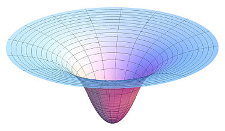
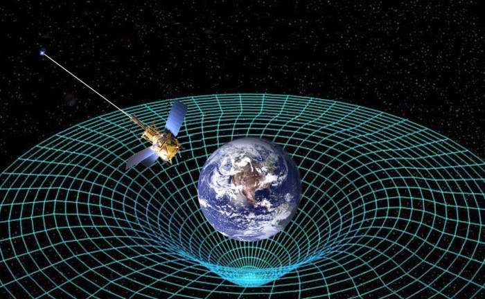
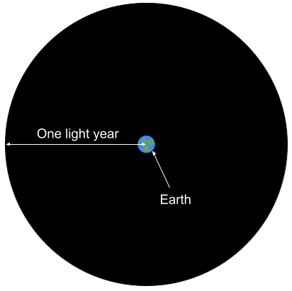
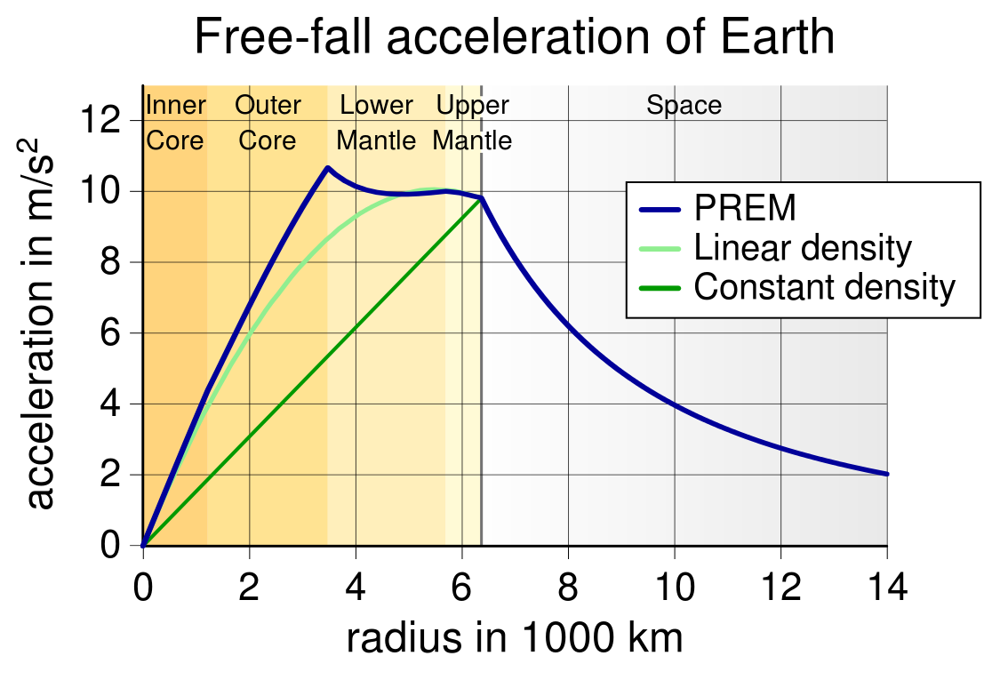
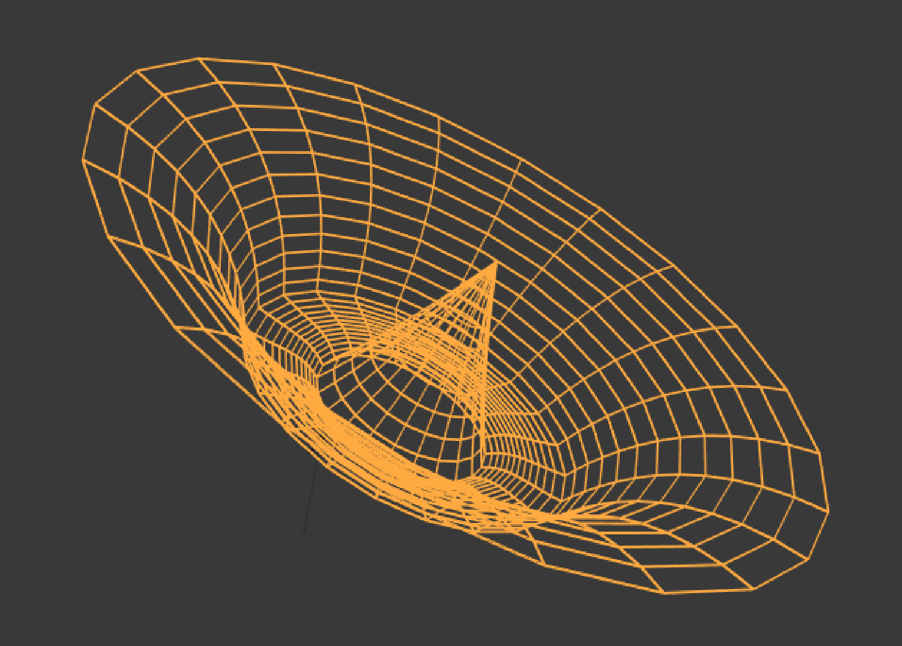

# Gravity Wells are Sombreros
###### Date: 20180921, Author: Zamicol, Tags: Gravity, Special Relativity, Time Dilation
###### Original post published Friday, September 21, 2018.  Modified 20260925

You've certainly seen an illustration of a gravity well, something like
[this](1):

Or maybe you've [seen one with Earth][1]:

Whenever I saw gravity well depictions in school I mistakenly assumed they
depicted gravity. They don't. These gravity wells depict [gravitational
potential][2], not gravity. Gravitational potential tells you how much time is
warped and how slow local time will progress due to [general relativity][3]. It
is not, however, correlated to what local gravity is. These "gravity wells" are
better thought of as "gravitational potential wells".

Another problem is that these illustrations work fine for distances far away
from massive bodies, but in massive regions of space, it is not how gravity
works. For example, [Xkcd's depiction][4] relates planet radius to gravity. The
depiction shows gravity up to the surface of the planets, but then sneakily
substitutes gravity with planet radius. The presentation obscures that no
information about gravity inside of the planets is provided! 

All these depictions we've all seen our whole lives all share one blunder: they
do not show how gravity works **in** massive bodies.

So then, what do gravity wells look like near and in massive bodies? To
illustrate, let's envision an empty volume of space with a one light year radius
and a single celestial body, for example Earth, in the center.

In this thought experiment where is the least and most gravity?

Based on the gravity well depiction, one might assume someone standing on the
edge of this miniverse would experience the least gravity and someone standing
in the middle would experience the most.

That's a reasonable answer based on previous depictions, but it's not true.

As a second guess, maybe gravity is the strongest at the Dead Sea, the North
Pole, the Mariana Trench, or Mt. Everest?

[Consider the following graph of Earth's gravity according to the Preliminary
Reference Earth Model (PREM)][5]. The region of most gravity is almost 3,000 km
below Earth's surface almost halfway to the core. The point of least gravity is
the center of the planet.

This tell us something surprising. The points of both most and least gravity are
both below the planet's surface!

The answer to our previous hypothetical was wrong. A miniverse with an Earth
like mass has the point of least gravity at the center and the volume and the
most gravity below the body's surface.

To match traditional gravity well depictions, this PREM graph can be flipped
upside down so that low gravity is up and high gravity is down. Mirroring the
graph shows a path down to the core and back up again. The result is a sombrero
cross section of Earth's gravity. Note that the highest point in gravity well,
the point of least gravity, is inside of the planet and not on the edges. The
edges approach zero, but never reach it. The point of the most time dilation is
the center of Earth, while the least time dilation is the point furthest away
from Earth.

How does zero acceleration relate to general relativity and time dilation? The
goal of this thought experiment is to emphasize that gravitational acceleration
is completely disconnected from gravitational time dilation. Although the
contrary is frequently said, and I've seen it endlessly confused, surprisingly
**gravitational time dilation is not dependent on acceleration**. Zero
gravitational acceleration is irrelevant.  That zero makes that point sharp!

Rather, general relativity uses the **instantaneous velocity**, via the metric
(and the clock hypothesis). Time dilation is always dependent on velocity, for
both special relativity and general relativity. This is obvious for special
relativity. In the case of gravity wells, time dilation is calculated based on
escape velocity. The higher the value for escape velocity, the larger the time
dilation.  Acceleration is only relevant for changing velocity, for both SR and
GR.

For more on gravitation time dilation and velocity, see my post, "Gravitation
Time Dilation is Not Caused by Acceleration", but for now, these three formulas
are sufficient:

Special relativity velocity time dilation:
$τ = t\sqrt{1-\frac{v^2}{c^2}}$

Escape velocity:
$v_e = \sqrt{\frac{2GM}{r}}$

Inserting $v=v_e$ gives general relativity time dilation:
$τ = t\sqrt{1 - \frac{2GM}{rc^2}}$

To match the traditional 3D depiction, Earth's gravity well looks something like
this.

Gravity wells are not just dips.

Gravity wells are sombreros.

[1]: https://phys.org/news/2016-01-strong-gravity-planets.html
[2]: https://en.wikipedia.org/wiki/Gravitational_potential
[3]: https://en.wikipedia.org/wiki/General_relativity
[4]: https://xkcd.com/681_large
[5]: https://en.wikipedia.org/wiki/Gravity_of_Earth