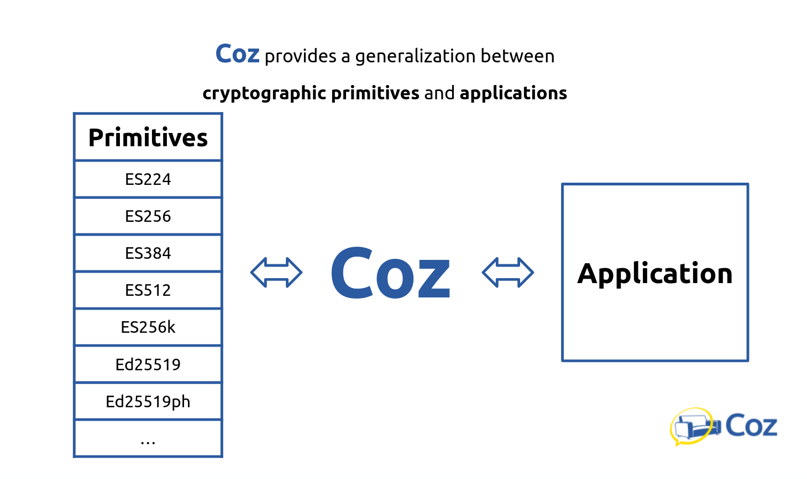
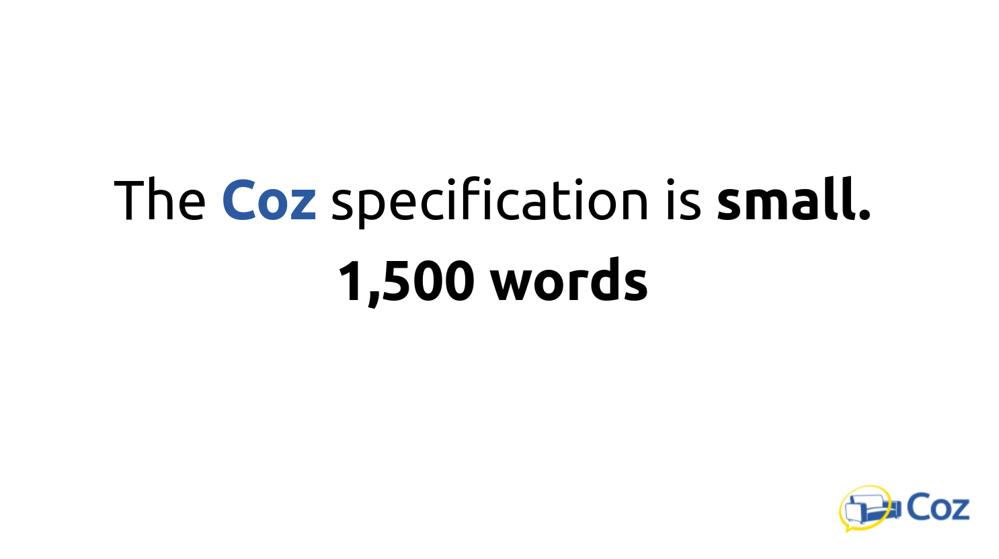

# Introduction to Coz
## Date: 1790000000


Coz is a cryptographic JSON messaging specification that uses digital signatures
and hashes to ensure secure, human-readable, and interoperable communication.

Coz uses digital signatures and hashes, in ordinary JSON, for human-readable and
interoperable messages.  The English word "coze", trimmed to "coz", means "a
friendly chat." That's the goal.

Coz is an intentionally small specification, only 1,500 words. Coz is a tiny
"language" for cryptographic signing: a thin generalization layer between
primitives (like ES256 or Ed25519) and applications.  

{width=520}


## Why we built it

Cyphr.me is deeply dependent on cryptography. We needed a dependable way to
reference messages through content addressing, prevent replay, prevent signature
malleability, and ship those properties without dragging a kitchen-sink standard
into every request.

We first worked privately, then released Coze publicly on June 8, 2021: thirty
years and one day after PGP 1.0.

The design goals are

1. Idiomatic JSON
2. Human readable
3. Small in scope
4. Defined cipher suites

Coz is JSON. This might be a surprise to hear, but it's real JSON. It's not JSON
stuffed into base64 stuffed into JSON. As JSON it's human readable: you can
easily read, build, or modify a coz. It's designed for humans to play with.

Most systems give primitives first-class priority and tightly couple to one of
them. Git's SHA-1 to SHA-256 migration is the perfect example: upgrading the
hash should have been a field, but is instead a massive project. 

Coz has a foundationally different philosophy: Coz gives the abstraction
first-class priority so primitives are easy to use or replace. Current
algorithms will need to be deprecated. Coz assumes that from day one.

And this is helped by a narrow scope. Coz does not try to be encryption, key
discovery, transport, and an identity system in one document. It signs JSON,
hashes and integrity protects JSON, names keys by thumbprint, and stops.  Coz
leaves space for composition with other systems, heading the wisdom of Unix.

{width=520}

## A coz

```json
{
  "pay": {
    "msg": "Coz is a cryptographic JSON messaging specification.",
    "alg": "ES256",
    "now": 1623132000,
    "tmb": "U5XUZots-WmQYcQWmsO751Xk0yeVi9XUKWQ2mGz6Aqg",
    "typ": "cyphr.me/msg/create"
  },
  "sig": "OJ4_timgp-wxpLF3hllrbe55wdjhzGOLgRYsGO1BmIMYbo4VKAdgZHnYyIU907ZTJkVr8B81A2K8U4nQA6ONEg"
}
```

This is the majority use case. `pay` is the signed payload, `sig` is the
signature, and anything not in `pay` is not signed.

Standard `pay` fields:

- `alg` — cipher suite. Example: `"ES256"`
- `now` — UTC Unix time of the signature
- `tmb` — thumbprint of the signing key
- `typ` — application type. Example: `"cyphr.me/msg/create"`

Everything else is application data. In the example, `msg` is additional. `typ`
is how applications say what a payload means: expected fields, versioning, which
handler to run.

Binary values, such as digests, use RFC 4648 base64url, canonical, padding
truncated (**b64ut**). "Base64" is too broad; there are eight RFC combinations
plus other variants in the wild. Coz picks one encoding and forbids the rest.
Signing and hashing are over UTF-8, brace to brace. Critically for security,
duplicate JSON fields result in an error. 

No field is strictly required. An empty `pay` with a valid `sig` is legitimate.
Omitting the standard fields only makes interoperability worse. As best
practice, all standard `pay` fields should be included but it isn't strictly
required.

## How to sign

0. Put your data in JSON.
1. Add Coz fields (`alg`, `now`, `tmb`, `typ`).
2. Drop insignificant whitespace. Field order of `pay` is the canon.
3. Hash that UTF-8 with the hash implied by `alg`. That digest is `cad`.
4. Sign the raw bytes of `cad`. Do not hash `cad` again. Put the signature in
   `sig`.

Your application's fields go in. Coz fields and a signature go on. Transport
happens. The other side verifies, then sees your fields again.

## Authenticated Atomic Action

Since each coz is authenticated by itself, sessions, bearer tokens, and
passwords are superseded. That's the idea of **Authenticated Atomic Action**
(AAA): one signed JSON object is one action.

If you are working on a JSON API and the transport is unknown, the usual answer
is TLS plus bearer tokens. Or just use Coz. Transport can be whatever, HTTPS,
plain HTTP, a queue, a file. Coz doesn't care. The message still verifies.

## Keys

A public Coz key:

```json
{
  "alg": "ES256",
  "now": 1623132000,
  "pub": "2nTOaFVm2QLxmUO_SjgyscVHBtvHEfo2rq65MvgNRjORojq39Haq9rXNxvXxwba_Xj0F5vZibJR3isBdOWbo5g",
  "tag": "Coz Example Key",
  "tmb": "U5XUZots-WmQYcQWmsO751Xk0yeVi9XUKWQ2mGz6Aqg"
}
```

`tmb` is the canonical digest of `["alg","pub"]` (more on that in a moment).
`prv` is never part of the thumbprint. A key with `prv` is private; a key with
`pub` and no `prv` is public. `tag` is human labeling.

`alg` is a parameter set. ES256 means ECDSA P-256 with SHA-256, with sizes and
encoding fixed by the reference implementation. Coz does not keep an IANA-style
registry and instead provides the Coz spec and the Go reference.

The same idea answers the questions every primitive leaves open. For Ed25519:
the private key is the seed, keys live in a Coz key object, encoding is b64ut,
high-S signatures are prohibited. Coz specifies precisely so applications do not
vary.

A key revokes itself by signing a coz with `rvk` greater than `0`. The current
Unix time is the suggested value. Third parties can publish a leaked key's
self-revoke. Systems that store Coz keys should accept a valid revoke whose
`pay` is under 2048 bytes and must treat the key as revoked immediately.


## Other features: Revoke, Canon, CAD, CZD
A critical design choice of JSON to understand is that JSON objects are
**unordered**, but JSON arrays and UTF-8itself is **ordered**. 

A **canon** is an array of field names. The canonical form exclusively canon
field, ordered, insignificant whitespace dropped, serialize to UTF-8, and hashed
with the algorithm specified by `alg`. Without canonicalization the spec would
be much larger. Canonicalization is a key reason why Coz stays small.

Coz has three significant digests:

- `tmb` — digest of `["alg","pub"]`, the key identifier
- `cad` — digest of `pay` (present ordered fields), unsigned message identifier
- `czd` — digest of `["cad","sig"]`, the signed message identifier

`czd` names a particular signed message the way `cad` names a particular
unsigned payload. Both are recalculatable and so should be omitted unless
otherwise needed. Because `sig` is used for `czd` as an identifier, signatures
must be non-malleable. For the existing ECDSA standard this means
implementations must canonicalize to low-S, which prevents malleability.
Preventing signature malleability is now widely regarded as best practice and we
anticipate new standards to provide non-malleability out of the box. If they
don't, Coz can specify a signature canonicalization format for those formats as
well.

## Coz Hardening
Coz spent a lot of time doing it's best to prevent other footguns. Some other
hardenings that other standards frequently forget about:

- No duplicate JSON fields
- No base64 malleability (canonical b64ut)
- No signature malleability
- `czd` as a built-in message identifier for replay protection
- Sign concrete UTF-8, not abstract JSON
- Self-revoke that third parties can publish

## Try it

- Spec and Go reference:
  [github.com/Cyphrme/Coz](https://github.com/Cyphrme/Coz)
- Live tool: [cyphr.me/coz](https://cyphr.me/coze)
- Presentation: [Coz
  slides](https://docs.google.com/presentation/d/1bVojfkDs7K9hRwjr8zMW-AoHv5yAZjKL9Z3Bicz5Too)

If you already know JOSE or JWT, the comparison post is [Coz Vs.
JOSE](https://cyphr.me/md/xlA-MSFwPxmWED4ZcNdxUy8OA22UPiLWlGQUQik8DwY). 

We use Coz throughout Cyphr.me. Implementations exist in Go and JavaScript; more
languages are welcome. We hope it is useful, or at least a clean, example of
what a small cryptographic JSON format can be.

We hope you enjoy Coz!
